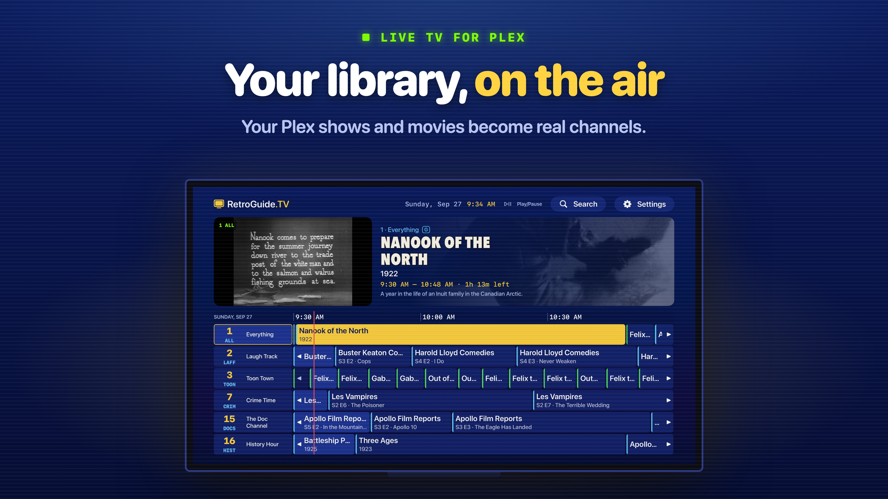
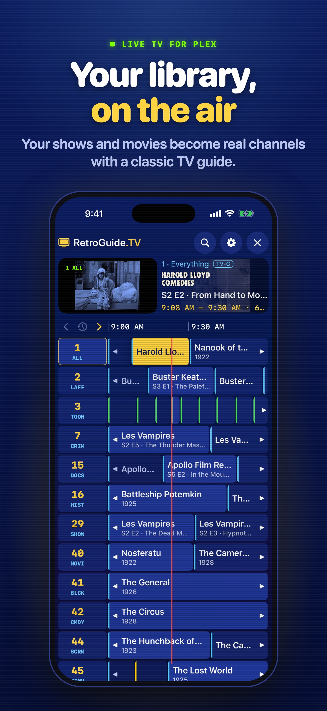

<p align="center">
  
</p>

<p align="center">
  <strong>Your media library, on the air.</strong><br>
  A native app for Apple TV, iPhone and iPad that turns your Plex or Jellyfin library into live TV channels with a classic program guide.
</p>

---

RetroGuide.TV builds dozens of always-on channels from the shows and movies you
already have: comedy, anime, sci-fi, 90s TV, 24/7 marathons of your favorite
series, and more. Turn it on and something is already playing. Flip channels with
the Siri Remote or a swipe, drop into whatever's on mid-episode, and browse what's
next in a cable-style guide.

## Download

[Get RetroGuide.TV on the App Store](https://apps.apple.com/app/apple-store/id6816213425?pt=128673019&ct=github_readme&mt=8)
for Apple TV, iPhone and iPad.

You need a Plex Media Server you own or that is shared with you, or a Jellyfin
server you can sign in to. **No media is included.** Apple TV is free with no ads; the free iPhone and iPad app shows ads.
An optional one-time RetroGuide Pro purchase removes mobile ads and unlocks
multiple servers, unlimited custom channels, all themes and schedule controls
across all three devices.

[Website](https://www.retroguide.tv/) ·
[Setup and support](https://www.retroguide.tv/support/) ·
[Privacy Policy](https://www.retroguide.tv/privacy/)

## Screenshots



<p align="center">
  
</p>

Actual interfaces shown with a public-domain demo library. Your channels are
built from your own Plex or Jellyfin media. [Screenshot credits](docs/images/CREDITS.md).

## Features

- **Automatic channels.** 50+ built-in genre, decade and format channels, plus
  channels for each library, TV network, large collection and long-running show.
  Channels with too little content are skipped, duplicates are removed, and the
  lineup scales to the size of your library.
- **Works with any library.** Genres are normalized across Plex agents,
  Jellyfin and languages (for example "Sci-Fi & Fantasy", "Science Fiction" and "Komödie"), and
  anime is recognized even without an "Anime" genre tag. Servers' genre tags are
  loose ("Mystery" on a fishing documentary), so RetroGuide checks well-known
  titles against its own classification, built from Wikidata and matched by IMDb,
  TMDB or TVDB id: loosely applied tags count only when it agrees, and
  documentaries, reality, game and talk shows stay off the channels built around
  fiction. "Why is this here?" in a channel's Options says why a show is on it,
  and with RetroGuide Pro a show can be removed from one channel.
- **Custom channels.** Combine genres, shows, networks, collections, decades,
  audiences and libraries, with a live preview of what the channel will air.
  One custom channel is free; unlimited custom channels require Pro.
- **Real TV scheduling (Pro controls).** Every channel runs on a fixed clock, so with the same
  library and settings, the same program is on at the same time on every Apple TV. Choose Shuffle, Block
  Shuffle, Show Rotation or Marathon ordering per channel, and optionally align
  start times to the quarter or half hour.
- **Program guide.** A focus-driven grid with a live preview, "now" line,
  rating colors, show logos and artwork, and search with live results.
- **Channel surfing.** Swipe to change channels, with static between channels,
  a glowing channel number and an info banner, and a button for the last
  channel.
- **Apple TV, iPhone and iPad.** Built for the Siri Remote on Apple TV and for
  touch on iPhone and iPad, in portrait or landscape.
- **Direct play.** A bundled [libmpv](https://mpv.io) player plays MKV, HEVC,
  AV1, Dolby Vision, DTS, TrueHD and ASS subtitles. Compatible files play
  directly; playback requirements depend on the file, device and server settings.
  Apple's player is available as a fallback.
- **HDR.** HDR10, HLG and Dolby Vision play in HDR on HDR iPhones and iPads. On
  Apple TV, **Match TV mode** switches the TV into HDR (and optionally to each
  program's frame rate) when Match Content is on in the Apple TV's settings.
- **Respects your settings.** Audio and subtitle tracks follow your Plex
  account's or Jellyfin user's language preferences, and your per-show choices.
- **Multiple servers (Pro).** Mix your own server with ones shared with you, Plex and
  Jellyfin together. The same title on several servers is kept once (matched by
  IMDb, TMDB or TVDB id when the servers name it differently), offline servers drop out of the guide
  until they're back, and each server has its own quality and buffering
  settings for playback over the internet.
- **Themes (all twelve with Pro).** Twelve themes, from Classic Cable and Local Forecast to VHS and
  Teletext, and optional CRT scanlines on menus. On iPhone and iPad, the app
  icon and What's On widget colors match the chosen theme.

- **Widgets and Picture in Picture.** See current programs in the What's On
  widget on iPhone and iPad, tap to tune in, and keep watching in a floating
  window while using other apps. The sleep timer stops at a chosen time or at
  the end of the current program, including Picture in Picture.
- **Favorites and reminders (Pro).** Star channels, browse and surf Favorites,
  and set local notifications for upcoming airings. Personalize widgets with
  Favorites, up to eight selected channels, or one pinned channel.

## Free and Pro

The App Store version is free with ads on iPhone and iPad (Apple TV has no
ads): a standard banner under the menus and, at most once per 90 minutes of
watching, a full-screen ad at a natural break. RetroGuide Pro is a one-time
purchase that removes ads and adds Favorites, program reminders, personalized
widgets, multiple servers, unlimited custom channels, every theme, schedule
controls, library-wide track rules and removing individual titles from channels.
The basic widget, Picture in Picture and sleep timer are free. One purchase
covers iPhone, iPad and Apple TV.

## Requirements

- Apple TV with tvOS 17 or later (Apple TV 4K recommended), or iPhone or iPad
  with iOS 17 or later
- A Plex Media Server you own or that is shared with you (servers outside your
  home must have Plex Remote Access enabled), or a Jellyfin server you can sign
  in to.
- HTTPS with a trusted certificate on every connected server, including local
  networks and VPNs. HTTP-only servers are not supported.

## Getting started

**Plex**

1. Open RetroGuide.TV and choose **Connect Plex**.
2. Go to [plex.tv/link](https://plex.tv/link) and enter the code shown on screen.
   On Apple TV you can scan the QR code; on iPhone and iPad, tap
   **Open plex.tv/link**.
3. Pick a server and the libraries to include, then choose **Build My Channels**.

**Jellyfin**

1. Open RetroGuide.TV and choose **Connect Jellyfin**. Servers on your network
   are found automatically; otherwise choose **Enter Address**.
2. Sign in with Quick Connect (approve the code in another Jellyfin app, under
   your profile) or with your username and password.
3. Pick the libraries to include, then choose **Build My Channels**.

Live TV starts as soon as your first server is indexed. Add more servers later in
**Settings → Servers**.

### Siri Remote

| Where | Button | Action |
| --- | --- | --- |
| Watching | Swipe up / down | Channel up / down |
| Watching | Swipe left / right | What's on now / next |
| Watching | Click | Open the guide |
| Watching | Play/Pause | Last channel |
| Guide | Click | Watch the highlighted channel |
| Guide | Play/Pause | Jump to Search and Settings |
| Anywhere | Menu | Back |

### Touch (iPhone and iPad)

| Where | Gesture | Action |
| --- | --- | --- |
| Watching | Swipe up / down | Channel up / down |
| Watching | Swipe right / left | What's on now / next |
| Watching | Tap | Show the info banner and controls (Guide, last channel, channel up / down) |
| Guide | Tap a program | Preview it; tap again or press Watch to tune |
| Guide | Tap a channel number | Watch that channel |
| Guide | Swipe sideways, or ‹ Now › | Move through the schedule |
| Search, Settings | Tap the corner picture | Back to full-screen TV |

## How it works

- **Indexing and playback reports.** RetroGuide.TV reads library metadata from
  your servers and caches it on the device, refreshing when it is more than six
  hours old. Jellyfin receives playback start, progress, pause and stop reports,
  including the played item, position and selected tracks. Its server settings
  determine how those reports affect watch progress and remembered choices.
  Audio and subtitle choices can be saved to Plex. The app keeps shared track
  rules locally and in iCloud; Jellyfin receives per-playback track choices,
  rather than a bulk per-show rule.
- **Scheduling.** Schedules are computed from the lineup and the date, never
  stored, so every device agrees. Shows take turns: each gets an equal share of
  turns however many episodes it has, and always continues with its next
  episode, in order; each channel starts each show at its own episode, so
  channels sharing shows don't move through them in step. Channels are
  scheduled together so the same show isn't on more than the chosen number of
  channels at once (24/7 and custom channels don't count) and the same episode
  or movie is never on two channels at once, 24/7 channels included. A 24/7
  channel's schedule repeats a fixed cycle, so both its position and the other
  channels' check against it are simple arithmetic. When a channel has nothing
  else it may air, it breaks the show limit before it repeats an episode, and
  airs something anyway rather than going dark.
- **Playback.** Only one stream plays at a time. Channel changes wait a moment
  while you're flipping, and the previous stream is released before the next one
  starts. With the default player the server just sends the original file, like
  any direct play.

## Privacy

RetroGuide.TV has no separate account system. It talks to plex.tv to link your
account and find your servers, and connects to your Plex or Jellyfin servers.
Jellyfin discovery checks your local network. Access tokens are stored in the
device keychain. Server API requests, artwork, subtitles and playback require
HTTPS, including redirects and playlist resources. Both players remain available.
Apple Player receives media through an authenticated, device-local loopback relay;
that internal connection never leaves the device. The parental PIN stays on the device as a salted verifier in
Keychain. Library metadata and local settings are cached on your device.
Chosen audio and subtitle preferences can also be saved to Plex, and shared
track rules can sync through iCloud.

The free iPhone and iPad app requests non-personalized ads from Google AdMob.
Non-personalized ads still involve data processing for advertising, measurement
and fraud prevention. Google's consent form appears where required, with
applicable privacy choices in Settings. Apple TV and RetroGuide Pro show no ads.
See the [Privacy Policy](https://www.retroguide.tv/privacy/) for details.

## Building from source

Requirements: macOS with Xcode 26 or later.

```bash
git clone https://github.com/shikyo13/RetroGuide.TV.git
cd RetroGuide.TV
open RetroGuide.xcodeproj
```

Choose the **RetroGuide** scheme and an Apple TV, iPhone or iPad simulator, then
run. To run on a device or archive, copy `Config/Local.xcconfig.example` to `Config/Local.xcconfig`
and set your Apple Developer Team ID (that file is git-ignored).

The Xcode project is generated from `project.yml` with
[XcodeGen](https://github.com/yonaskolb/XcodeGen). After changing `project.yml`,
run `xcodegen generate` and commit the updated project.

Run the core library's tests with:

```bash
swift test --package-path Packages/RetroGuideKit
```

### Project layout

```
App/                      App for tvOS, iOS and iPadOS (SwiftUI)
  Composition/            App state, servers, lineup building
  DesignSystem/           Tokens, themes and shared components
  Features/               Onboarding, Watch (player + guide), Search, Settings
  Services/               Playback engines, images, persistence
Packages/RetroGuideKit/   Platform-independent core: models, channel rules,
                          scheduling, search and the Plex and Jellyfin
                          clients (unit tested)
Tools/BrandAssets/        Generates the app icon and Top Shelf images
Scripts/                  Build phase scripts
```

See [docs/ARCHITECTURE.md](docs/ARCHITECTURE.md) for a deeper tour.

## Contributing

Bug reports, ideas and pull requests are welcome. Please read
[CONTRIBUTING.md](CONTRIBUTING.md) first.

## License

RetroGuide.TV is released under the [MIT License](LICENSE). It bundles
[MPVKit](https://github.com/mpvkit/MPVKit) (libmpv and FFmpeg) under the GNU LGPL
v3.0; see [NOTICE.md](NOTICE.md).

RetroGuide.TV is an independent project and is not affiliated with or endorsed
by Plex, Inc. or the Jellyfin project. Plex is a trademark of Plex, Inc.
